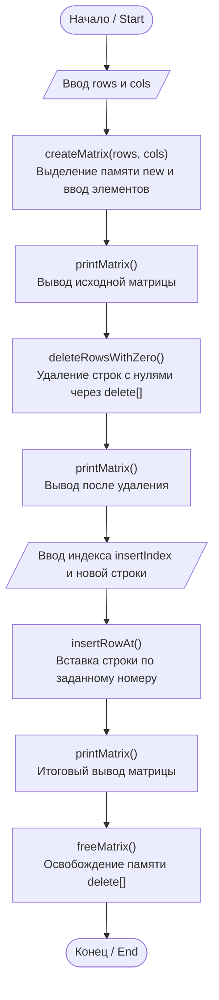

# Отчет по лабораторной работе №10

<div align="center">

# 🎓 МИНИСТЕРСТВО ОБРАЗОВАНИЯ И НАУКИ РОССИЙСКОЙ ФЕДЕРАЦИИ
### Кафедра Автоматизированных систем управления (АСУ)

---

## 👤 Студенческая Визитная Карточка

| 📝 Личные данные студента | 🔍 Официальная информация |
| :--- | :--- |
| **ФИО Студента** | <span style="color: #238636;"><b>[Мухаммад Майя]</b></span> |
| **Номер группы** | <span style="color: #1f6feb;"><b>[ИВТ-26-1б]</b></span> |
| **Специальность** | Инженерная информатика (АСУ) |
| **Дисциплина** | Программирование на языке С++ |

</div>

---

## 📌 Постановка задачи

**Динамические массивы (Вариант 27):**
1. Сформировать двумерный динамический массив с использованием операций `new` и `delete`.
2. Удалить из него все строки, содержащие нулевые элементы.
3. Добавить новую строку с заданным номером (индексом).

> 🌐 **[EN]** Task setup (Dynamic Arrays — Variant 27): 1) Create a 2D dynamic array using `new` and `delete`. 2) Delete all rows containing zero elements. 3) Insert a new row at a specified row index.
> 🌐 **[AR]** صياغة المسألة (المصفوفات الديناميكية — النموذج 27): 1) تكوين مصفوفة ثنائية الأبعاد ديناميكية باستخدام `new` و `delete`. 2) حذف جميع الصفوف التي تحتوي على عناصر صفرية. 3) إضافة صف جديد برقم (فهرس) محدد.

---

## 🗺️ Блок-схема алгоритма программы (Flowchart)

<div align="center">



</div>

---

## 🧩 Пошаговый разбор кода (Step-by-Step Code Explanation)

### 🔹 Шаг 1: Подключение библиотек (Header Files)

```cpp
#include <iostream>
#include <iomanip>

using namespace std;
```

Подключаются библиотеки `iostream` (для ввода и вывода данных в консоль) и `iomanip` (для выравнивания столбцов матрицы при помощи манипулятора `setw`).

> 🌐 **[EN]** Includes `iostream` (for console input/output) and `iomanip` (for aligning matrix columns using `setw`).
> 🌐 **[AR]** استدعاء مكتبتي `iostream` (للإدخال والإخراج عبر الشاشة) و `iomanip` (لتنسيق أعمدة المصفوفة ومحاذاة الأرقام باستخدام `setw`).

---

### 🔹 Шаг 2: Выделение памяти и заполнение матрицы `createMatrix()`

```cpp
int** createMatrix(int rows, int cols)
{
    int** matrix = new int*[rows]; // حجز مصفوفة مؤشرات للصفوف
    cout << "\nEnter the matrix elements row by row:\n";
    for (int i = 0; i < rows; ++i)
    {
        matrix[i] = new int[cols]; // حجز أعمدة كل صف
        cout << "Row " << i << " (" << cols << " integers): ";
        for (int j = 0; j < cols; ++j)
        {
            cin >> matrix[i][j];
        }
    }
    return matrix;
}
```

Динамический двумерный массив создаётся в два этапа: сначала выделяется массив указателей `new int*[rows]`, а затем в цикле для каждой строки выделяется массив элементов `new int[cols]` и считываются значения с клавиатуры.

> 🌐 **[EN]** Allocates a 2D dynamic array in two steps: first an array of row pointers `new int*[rows]`, then inside a loop an array of `cols` integers `new int[cols]` for each row, reading elements from the user.
> 🌐 **[AR]** يتم إنشاء المصفوفة الثنائية الديناميكية على مرحلتين: أولاً حجز مصفوفة مؤشرات للصفوف `new int*[rows]`، ثم داخل حلقة تكرار حجز أعمدة كل صف `new int[cols]` وقراءة قيمه من المستخدم.

---

### 🔹 Шаг 3: Функция форматированного вывода матрицы `printMatrix()`

```cpp
void printMatrix(int** matrix, int rows, int cols)
{
    cout << "\n---------------------------------------------------------\n";
    if (rows == 0)
    {
        cout << "(Matrix has 0 rows - completely empty)\n";
        cout << "---------------------------------------------------------\n";
        return;
    }

    for (int i = 0; i < rows; ++i)
    {
        cout << "Row [" << i << "]: ";
        for (int j = 0; j < cols; ++j)
        {
            cout << setw(5) << matrix[i][j];
        }
        cout << "\n";
    }
    cout << "---------------------------------------------------------\n";
}
```

Функция проверяет, не пуста ли матрица (`rows == 0`), а затем построчно выводит все элементы с указанием индекса каждой строки и шириной поля 5 символов (`setw(5)`).

> 🌐 **[EN]** Checks if the matrix is empty (`rows == 0`), then prints all rows with their indices and 5-character column width (`setw(5)`).
> 🌐 **[AR]** تتحقق الدالة مما إذا كانت المصفوفة فارغة (`rows == 0`)، ثم تطبع جميع الصفوف مع أرقامها وتنسيق عرض كل عمود بمسافة 5 خانات (`setw(5)`).

---

### 🔹 Шаг 4: Вспомогательная функция проверки строки на нули `hasZero()`

```cpp
bool hasZero(const int* row, int cols)
{
    for (int j = 0; j < cols; ++j)
    {
        if (row[j] == 0)
        {
            return true;
        }
    }
    return false;
}
```

Функция просматривает все элементы переданной строки `row`. Как только встречается элемент, равный `0`, она немедленно возвращает `true`; если нулей нет — возвращает `false`.

> 🌐 **[EN]** Scans all elements in a given `row`. Returns `true` immediately if any element equals `0`; otherwise returns `false`.
> 🌐 **[AR]** تفحص الدالة جميع عناصر الصف الممرر `row`؛ وبمجرد العثور على عنصر يساوي `0` تُرجع `true` فوراً، وإذا لم يوجد أي صفر تُرجع `false`.

---

### 🔹 Шаг 5: Удаление строк, содержащих нулевые элементы `deleteRowsWithZero()`

```cpp
int** deleteRowsWithZero(int** matrix, int& rows, int cols)
{
    int validRows = 0;
    for (int i = 0; i < rows; ++i)
    {
        if (!hasZero(matrix[i], cols))
        {
            validRows++;
        }
    }

    int deletedCount = rows - validRows;
    if (deletedCount == 0)
    {
        cout << "\n[INFO] No rows contain zero elements. Nothing deleted.\n";
        return matrix;
    }

    int** newMatrix = (validRows > 0) ? new int*[validRows] : nullptr;
    int newIdx = 0;

    for (int i = 0; i < rows; ++i)
    {
        if (hasZero(matrix[i], cols))
        {
            delete[] matrix[i];
        }
     else
        {
            newMatrix[newIdx++] = matrix[i];
        }
    }

    delete[] matrix;
    rows = validRows;

    cout << "\n[SUCCESS] Deleted " << deletedCount << " row(s) containing zero elements.\n";
    return newMatrix;
}
```

Сначала подсчитывается количество строк без нулей (`validRows`). Если есть строки для удаления, выделяется новый массив указателей `newMatrix`: память строк с нулями освобождается (`delete[] matrix[i]`), указатели на остальные строки переносятся в `newMatrix`, старый массив указателей удаляется (`delete[] matrix`), а переменная `rows` обновляется по ссылке.

> 🌐 **[EN]** First counts rows without zeros (`validRows`). If any row has a zero, allocates `newMatrix`, frees zero-containing rows via `delete[] matrix[i]`, transfers valid row pointers, deletes the old pointer array `delete[] matrix`, and updates `rows` by reference.
> 🌐 **[AR]** تحسب الدالة أولاً عدد الصفوف الخالية من الأصفار (`validRows`). إذا وُجدت صفوف تحتوي على أصفار، يتم إنشاء مصفوفة مؤشرات جديدة `newMatrix` وتحرير ذاكرة الصفوف المحذوفة (`delete[] matrix[i]`) ونقل الصفوف السليمة ثم حذف مصفوفة المؤشرات القديمة (`delete[] matrix`).

---

### 🔹 Шаг 6: Вставка новой строки с заданным номером `insertRowAt()`

```cpp
int** insertRowAt(int** matrix, int& rows, int cols, int insertIndex)
{
    if (insertIndex < 0 || insertIndex > rows)
    {
        cerr << "[ERROR] Invalid row index! Must be between 0 and " << rows << ".\n";
        return matrix;
    }

    int* newRow = new int[cols];
    cout << "Enter " << cols << " elements for the new row:\n> ";
    for (int j = 0; j < cols; ++j)
    {
        cin >> newRow[j];
    }

    int** newMatrix = new int*[rows + 1];

    for (int i = 0; i < insertIndex; ++i)
    {
        newMatrix[i] = matrix[i];
    }

    newMatrix[insertIndex] = newRow;

    for (int i = insertIndex; i < rows; ++i)
    {
        newMatrix[i + 1] = matrix[i];
    }

    delete[] matrix;
    rows++;

    cout << "\n[SUCCESS] New row inserted at index " << insertIndex << "!\n";
    return newMatrix;
}
```

Проверяется корректность введённого индекса `insertIndex` (от `0` до `rows`). Выделяется память под новую строку `newRow` и новый массив указателей размером `rows + 1`. Указатели копируются со сдвигом на 1 после позиции `insertIndex`, старый массив указателей освобождается, а `rows` увеличивается на 1.

> 🌐 **[EN]** Validates `insertIndex` (`0` to `rows`). Allocates `newRow` and a new pointer array of size `rows + 1`, copies pointers before `insertIndex`, places `newRow` at `insertIndex`, shifts remaining pointers by +1, frees the old pointer array, and increments `rows`.
> 🌐 **[AR]** تتحقق الدالة من صحة رقم الصف المدخل `insertIndex`، ثم تحجز ذاكرة للصف الجديد `newRow` ومصفوفة مؤشرات جديدة بحجم `rows + 1`، وتنسخ الصفوف السابقة وتضع الصف الجديد في موضعه المحدد ثم تنقل باقي الصفوف وتحرر مصفوفة المؤشرات القديمة.

---

### 🔹 Шаг 7: Полное освобождение памяти `freeMatrix()` и функция `main()`

```cpp
void freeMatrix(int** matrix, int rows)
{
    if (matrix != nullptr)
     {
        for (int i = 0; i < rows; ++i)
        {
            delete[] matrix[i];
        }
        delete[] matrix;
    }
}
```

Перед завершением программы функция `freeMatrix()` освобождает память каждой оставшейся строки (`delete[] matrix[i]`), а затем самого массива указателей (`delete[] matrix`), предотвращая утечки памяти.

> 🌐 **[EN]** Before program termination, `freeMatrix()` deallocates every remaining row (`delete[] matrix[i]`) and then the pointer array itself (`delete[] matrix`), preventing memory leaks.
🌐 [AR] قبل انتهاء البرنامج تقوم الدالة freeMatrix() بتحرير ذاكرة كل صف متبقٍ (delete[] matrix[i]) ثم مصفوفة المؤشرات نفسها (delete[] matrix) لمنع حدوث تسرب في الذاكرة (Memory Leak).

💻 Полный исходный код программы (Full Source Code)
```cpp
#include <iostream>
#include <iomanip>

using namespace std;

// 1. دالة حجز وتعبئة مصفوفة ثنائية ديناميكية باستخدام new
int** createMatrix(int rows, int cols)
{
    int** matrix = new int*[rows]; // حجز مصفوفة مؤشرات للصفوف
    cout << "\nEnter the matrix elements row by row:\n";
    for (int i = 0; i < rows; ++i)
    {
        matrix[i] = new int[cols]; // حجز أعمدة كل صف
        cout << "Row " << i << " (" << cols << " integers): ";
        for (int j = 0; j < cols; ++j)
        {
            cin >> matrix[i][j];
        }
    }
    return matrix;
}

// 2. دالة طباعة المصفوفة بشكل منسق
void printMatrix(int** matrix, int rows, int cols)
{
    cout << "\n---------------------------------------------------------\n";
    if (rows == 0)
    {
        cout << "(Matrix has 0 rows - completely empty)\n";
        cout << "---------------------------------------------------------\n";
        return;
    }

    for (int i = 0; i < rows; ++i)
    {
        cout << "Row [" << i << "]: ";
        for (int j = 0; j < cols; ++j)
        {
            cout << setw(5) << matrix[i][j];
        }
        cout << "\n";
    }
    cout << "---------------------------------------------------------\n";
}

// دالة مساعدة للتحقق هل يحتوي الصف على عنصر يساوي صفراً أم لا
bool hasZero(const int* row, int cols)
{
    for (int j = 0; j < cols; ++j)
    {
        if (row[j] == 0)
        {
            return true;
        }
    }
    return false;
}

// 3. دالة حذف جميع الصفوف التي تحتوي على أصفار
int** deleteRowsWithZero(int** matrix, int& rows, int cols)
{
    // حساب عدد الصفوف التي لا تحتوي على أصفار
    int validRows = 0;
    for (int i = 0; i < rows; ++i)
    {
        if (!hasZero(matrix[i], cols))
        {
            validRows++;
        }
    }

    int deletedCount = rows - validRows;
    if (deletedCount == 0)
    {
        cout << "\n[INFO] No rows contain zero elements. Nothing deleted.\n";
        return matrix;
    }

    // إنشاء مصفوفة مؤشرات جديدة بالحجم الجديد
    int** newMatrix = (validRows > 0) ? new int*[validRows] : nullptr;
    int newIdx = 0;

    for (int i = 0; i < rows; ++i)
    {
        if (hasZero(matrix[i], cols))
        {
            delete[] matrix[i]; // تحرير ذاكرة الصف المحذوف فوراً
        }
    else
        {
            newMatrix[newIdx++] = matrix[i]; // نقل مؤشر الصف السليم للمصفوفة الجديدة
        }
    }

    delete[] matrix; // تحرير مصفوفة المؤشرات القديمة
    rows = validRows;

    cout << "\n[SUCCESS] Deleted " << deletedCount << " row(s) containing zero elements.\n";
    return newMatrix;
}

// 4. دالة إضافة صف جديد في موضع محدد (برقم الصف)
int** insertRowAt(int** matrix, int& rows, int cols, int insertIndex)
{
    // التحقق من صحة رقم الصف المدخل
    if (insertIndex < 0 || insertIndex > rows)
    {
        cerr << "[ERROR] Invalid row index! Must be between 0 and " << rows << ".\n";
        return matrix;
    }

    // حجز الصف الجديد وقراءة عناصره من المستخدم
    int* newRow = new int[cols];
    cout << "Enter " << cols << " elements for the new row:\n> ";
    for (int j = 0; j < cols; ++j)
    {
        cin >> newRow[j];
    }

    // إنشاء مصفوفة مؤشرات جديدة أكبر بصف واحد
    int** newMatrix = new int*[rows + 1];

    // نسخ الصفوف التي تسبق موضع الإدراج
    for (int i = 0; i < insertIndex; ++i)
    {
        newMatrix[i] = matrix[i];
    }

    // وضع الصف الجديد في الموضع المطلوب
    newMatrix[insertIndex] = newRow;

    // نسخ باقي الصفوف بعد الصف الجديد
    for (int i = insertIndex; i < rows; ++i)
    {
        newMatrix[i + 1] = matrix[i];
    }

    delete[] matrix; // تحرير مصفوفة المؤشرات القديمة
    rows++;

    cout << "\n[SUCCESS] New row inserted at index " << insertIndex << "!\n";
    return newMatrix;
}

// 5. دالة تحرير كامل الذاكرة المحجوزة للمصفوفة قبل إنهاء البرنامج
void freeMatrix(int** matrix, int rows)
{
    if (matrix != nullptr)
    {
        for (int i = 0; i < rows; ++i)
        {
            delete[] matrix[i];
        }
        delete[] matrix;
    }
}

int main()
{
    cout << "=========================================================\n";
    cout << "     LABORATORY WORK #10: DYNAMIC 2D ARRAYS (new/delete) \n";
    cout << "=========================================================\n\n";

    int rows, cols;
    cout << "1. Enter initial number of rows:\n> ";
    cin >> rows;
    cout << "2. Enter number of columns:\n> ";
    cin >> cols;

    if (rows <= 0 || cols <= 0)
    {
        cerr << "[ERROR] Dimensions must be positive integers!\n";
        return 1;
    }

    // 1. تكوين المصفوفة وطباعتها
    int** matrix = createMatrix(rows, cols);
    cout << "\nInitial Matrix:";
    printMatrix(matrix, rows, cols);

    // 2. حذف الصفوف التي تحتوي على أصفار
    matrix = deleteRowsWithZero(matrix, rows, cols);
    cout << "Matrix after deleting rows with zeros:";
    printMatrix(matrix, rows, cols);

    // 3. إضافة صف جديد برقم محدد
    int insertIndex;
    cout << "\nEnter the row index where you want to INSERT a new row (0 to " << rows << "):\n> ";
    cin >> insertIndex;

    matrix = insertRowAt(matrix, rows, cols, insertIndex);
    cout << "Final Matrix after insertion:";
    printMatrix(matrix, rows, cols);

    // تحرير الذاكرة بالكامل
    freeMatrix(matrix, rows);

    return 0;
}

```

🖥️ Пример работы программы (Консоль)

```cpp

=========================================================
     LABORATORY WORK #10: DYNAMIC 2D ARRAYS (new/delete) 
=========================================================

1. Enter initial number of rows:
> 4
2. Enter number of columns:
> 4

Enter the matrix elements row by row:
Row 0 (4 integers): 1 1 1 1   
Row 1 (4 integers): 1 1 1 1 
Row 2 (4 integers): 1 1 1 1 
Row 3 (4 integers): 1 1 1 1 

Initial Matrix:
---------------------------------------------------------
Row:     1    1    1    1
Row:     1    1    1    1
Row:     1    1    1    1
Row:     1    1    1    1
---------------------------------------------------------

[INFO] No rows contain zero elements. Nothing deleted.
Matrix after deleting rows with zeros:
---------------------------------------------------------
Row:     1    1    1    1
Row:     1    1    1    1
Row:     1    1    1    1
Row:     1    1    1    1
---------------------------------------------------------

Enter the row index where you want to INSERT a new row (0 to 4):
> 2
Enter 4 elements for the new row:
> 2 2 2 2 

[SUCCESS] New row inserted at index 2!
Final Matrix after insertion:
---------------------------------------------------------
Row:     1    1    1    1
Row:     1    1    1    1
Row:     2    2    2    2
Row:     1    1    1    1
Row:     1    1    1    1
---------------------------------------------------------

