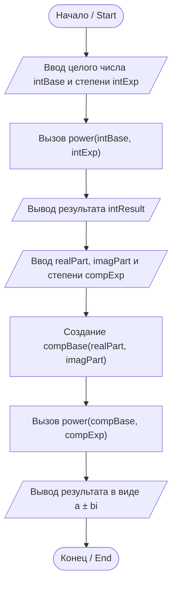

# Отчет по лабораторной работе №7

<div align="center">

# 🎓 МИНИСТЕРСТВО ОБРАЗОВАНИЯ И НАУКИ РОССИЙСКОЙ ФЕДЕРАЦИИ
### Кафедра Автоматизированных систем управления (АСУ)

---

## 👤 Студенческая Визитная Карточка

| 📝 Личные данные студента | 🔍 Официальная информация |
| :--- | :--- |
| **ФИО Студента** | <span style="color: #238636;"><b>[Мухаммад Майя]</b></span> |
| **Номер группы** | <span style="color: #1f6feb;"><b>[ИВТ-26-1б]</b></span> |
| **Специальность** | Инженерная информатика (АСУ) |
| **Дисциплина** | Программирование на языке С++ |

</div>

---

## 📌 Постановка задачи

Написать перегруженные функции и основную программу, которая их вызывает (Вариант 27):
а) для возведения целого числа в степень;
б) для возведения комплексного числа в степень.

> 🌐 **[EN]** Task setup: Write overloaded functions and a main program that calls them (Variant 27): a) for raising an integer to a power; b) for raising a complex number to a power.
> 🌐 **[AR]** صياغة المسألة: كتابة دوال محملة زائداً (Overloaded Functions) وبرنامج رئيسي يقوم باستدعائها (النموذج 27): أ) لرفع عدد صحيح إلى أس؛ ب) لرفع عدد مركب إلى أس.

---

## 🗺️ Блок-схема алгоритма программы (Flowchart)

<div align="center">



</div>

---

## 🧩 Пошаговый разбор кода (Step-by-Step Code Explanation)

### 🔹 Шаг 1: Подключение библиотек (Header Files)

```cpp
#include <iostream>
#include <complex>
#include <cmath>

using namespace std;
```

Подключаются библиотеки `iostream` (для консольного ввода-вывода), `complex` (для работы с комплексными числами) и `cmath` (для функции модуля `abs`). Директива `using namespace std;` позволяет использовать стандартные имена без префикса `std::`.

> 🌐 **[EN]** Includes `iostream` (for console I/O), `complex` (for handling complex numbers), and `cmath` (for the `abs` function). `using namespace std;` allows using standard names without the `std::` prefix.
> 🌐 **[AR]** استدعاء مكتبات `iostream` (للإدخال والإخراج)، و `complex` (للتعامل مع الأعداد المركبة)، و `cmath` (لاستخدام دالة القيمة المطلقة `abs`). السطر الأخير يغني عن كتابة `std::` قبل الأوامر.

---

### 🔹 Шаг 2: Перегруженная функция для целого числа (Overloaded Function for Integer)

```cpp
double power(int base, int exponent) {
    if (exponent == 0) {
        return 1.0;
    }

    double result = 1.0;
    int absExp = abs(exponent);

    for (int i = 0; i < absExp; ++i) {
        result *= base;
    }

    if (exponent < 0) {
        return 1.0 / result;
    }

    return result;
}
```

Первая перегруженная функция `power` принимает целое основание `base` и степень `exponent`. Если степень равна `0`, возвращается `1.0`. В цикле `for` число умножается само на себя `abs(exponent)` раз. При отрицательной степени возвращается обратное значение `1.0 / result`.

> 🌐 **[EN]** The first overloaded function `power` takes an integer `base` and `exponent`. If the exponent is `0`, it returns `1.0`. A `for` loop multiplies the base by itself `abs(exponent)` times. For negative exponents, it returns `1.0 / result`.
> 🌐 **[AR]** الدالة الأولى المحملة زائداً `power` تستقبل أساساً صحيحاً `base` وأساً `exponent`. إذا كان الأس `0` تُرجع `1.0`، وفي حلقة التكرار يُضرب الأساس في نفسه بعدد مرات القيمة المطلقة للأس، وإذا كان الأس سالباً تُرجع مقلوب الناتج `1.0 / result`.

---

### 🔹 Шаг 3: Перегруженная функция для комплексного числа (Overloaded Function for Complex Number)

```cpp
complex<double> power(complex<double> base, int exponent) {
    if (exponent == 0) {
        return complex<double>(1.0, 0.0);
    }

    complex<double> result(1.0, 0.0);
    int absExp = abs(exponent);

    for (int i = 0; i < absExp; ++i) {
        result *= base;
    }

    if (exponent < 0) {
        return complex<double>(1.0, 0.0) / result;
    }

    return result;
}
```

Вторая функция с тем же именем `power` принимает объект `complex<double>`. Логика аналогична первой функции, но умножение и деление выполняются по правилам арифметики комплексных чисел.

> 🌐 **[EN]** The second function with the same name `power` accepts a `complex<double>` object. The logic mirrors the first function, performing multiplication and division according to complex number arithmetic.
> 🌐 **[AR]** الدالة الثانية التي تحمل نفس الاسم `power` تستقبل عدداً مركباً `complex<double>`. تعمل بنفس منطق الدالة الأولى ولكنها تنفذ عمليات الضرب والقسمة وفق قواعد الأعداد المركبة.

---

### 🔹 Шаг 4: Ввод и расчет для целого числа в `main()`

```cpp
    int intBase, intExp;
    cout << "[Part 1: Integer Number]\n";
    cout << "1. Enter an integer base number (e.g., 2):\n> ";
    cin >> intBase;

    cout << "2. Enter the integer exponent (power, e.g., 3 or -2):\n> ";
    cin >> intExp;

    double intResult = power(intBase, intExp);
    cout << "-> Result: " << intBase << "^" << intExp << " = " << intResult << "\n";
```

В функции `main()` считываются целое основание и показатель степени. Компилятор автоматически выбирает первую версию функции `power(int, int)` по типам переданных аргументов и выводит результат.

> 🌐 **[EN]** In `main()`, the integer base and exponent are read from the user. The compiler automatically selects the first `power(int, int)` overload based on argument types and prints the result.
> 🌐 **[AR]** في الدالة الرئيسية `main()` يتم قراءة الأساس والأس الصحيحين من المستخدم، ويقوم المترجم تلقائياً باختيار النسخة الأولى من دالة `power` بناءً على نوع المعاملات ثم يطبع النتيجة.

---

### 🔹 Шаг 5: Ввод и форматированный вывод для комплексного числа

```cpp
    double realPart, imagPart;
    int compExp;
    cout << "[Part 2: Complex Number (a + bi)]\n";
    cout << "1. Enter the real part (a) of the complex number:\n> ";
    cin >> realPart;

    cout << "2. Enter the imaginary part (b) of the complex number:\n> ";
    cin >> imagPart;

    cout << "3. Enter the integer exponent (power) for the complex number:\n> ";
    cin >> compExp;

    complex<double> compBase(realPart, imagPart);
    complex<double> compResult = power(compBase, compExp);

    char sign = (compResult.imag() >= 0) ? '+' : '-';
    cout << "-> Result: (" << realPart << (imagPart >= 0 ? " + " : " - ") << abs(imagPart) << "i)^" << compExp
         << " = " << compResult.real() << " " << sign << " " << abs(compResult.imag()) << "i\n";
```

Считываются действительная (`a`) и мнимая (`b`) части комплексного числа, а также степень. Создается объект `compBase`, вызывается вторая перегруженная функция `power(complex<double>, int)`, а результат выводится в привычной алгебраической форме `a ± bi`.

> 🌐 **[EN]** The real (`a`) and imaginary (`b`) parts of the complex number and the exponent are read. The `compBase` object is created, the second `power(complex<double>, int)` overload is called, and the result is formatted cleanly as `a ± bi`.
> 🌐 **[AR]** يتم قراءة الجزء الحقيقي (`a`) والتخيلي (`b`) للعدد المركب والأس، ثم إنشاء الكائن `compBase` واستدعاء النسخة الثانية من الدالة `power`، وطباعة النتيجة بصيغة رياضية منسقة `a ± bi`.

---

## 💻 Полный исходный код программы (Full Source Code)

```cpp
#include <iostream>
#include <complex>
#include <cmath>

using namespace std;

// أ) دالة محملة زائداً (Overloaded) لرفع عدد صحيح إلى أس صحيح
double power(int base, int exponent) {
    // أي عدد مرفوع للأس صفر يساوي 1
    if (exponent == 0) {
        return 1.0;
    }

    double result = 1.0;
    int absExp = abs(exponent); // أخذ القيمة المطلقة للأس لتكرار الضرب

    // حلقة تكرارية لضرب الأساس في نفسه بعدد مرات الأس
    for (int i = 0; i < absExp; ++i) {
        result *= base;
    }

    // معالجة الأس السالب (مثال: 2^-3 = 1 / 8)
    if (exponent < 0) {
        return 1.0 / result;
    }

    return result;
}

// ب) دالة محملة زائداً (Overloaded) لرفع عدد مركب إلى أس صحيح
complex<double> power(complex<double> base, int exponent) {
    // أي عدد مركب مرفوع للأس صفر يساوي (1 + 0i)
    if (exponent == 0) {
        return complex<double>(1.0, 0.0);
    }

    complex<double> result(1.0, 0.0);
    int absExp = abs(exponent); // أخذ القيمة المطلقة للأس

    // حلقة تكرارية لضرب العدد المركب في نفسه
    for (int i = 0; i < absExp; ++i) {
        result *= base;
    }

    // معالجة الأس السالب للعدد المركب (1 / z^|n|)
    if (exponent < 0) {
        return complex<double>(1.0, 0.0) / result;
    }

    return result;
}

int main() {
    // طباعة ترويسة البرنامج للمستخدم
    cout << "=========================================================\n";
    cout << "       Power Calculation Program (Overloaded Functions)  \n";
    cout << "=========================================================\n\n";

    // --- الجزء الأول: حساب أس العدد الصحيح ---
    int intBase, intExp;
    cout << "[Part 1: Integer Number]\n";
    cout << "1. Enter an integer base number (e.g., 2):\n> ";
    cin >> intBase;

    cout << "2. Enter the integer exponent (power, e.g., 3 or -2):\n> ";
    cin >> intExp;

    // استدعاء الدالة الأولى الخاصة بالأعداد الصحيحة
    double intResult = power(intBase, intExp);
    cout << "-> Result: " << intBase << "^" << intExp << " = " << intResult << "\n";
    cout << "---------------------------------------------------------\n\n";

    // --- الجزء الثاني: حساب أس العدد المركب ---
    double realPart, imagPart;
int compExp;
cout << "[Part 2: Complex Number (a + bi)]\n";
cout << "1. Enter the real part (a) of the complex number:\n> ";
cin >> realPart;
cout << "2. Enter the imaginary part (b) of the complex number:\n> ";
cin >> imagPart;
cout << "3. Enter the integer exponent (power) for the complex number:\n> ";
cin >> compExp;
// تكوين العدد المركب واستدعاء الدالة الثانية الخاصة بالأعداد المركبة
complex compBase(realPart, imagPart);
complex compResult = power(compBase, compExp);
// تنسيق الطباعة لإظهار العدد المركب بشكل رياضي أنيق (a + bi) أو (a - bi)
char sign = (compResult.imag() >= 0) ? '+' : '-';
cout << "-> Result: (" << realPart << (imagPart >= 0 ? " + " : " - ") << abs(imagPart) << "i)^" << compExp
<< " = " << compResult.real() << " " << sign << " " << abs(compResult.imag()) << "i\n";
cout << "=========================================================\n";
return 0;
}

```

## 🖥️ Пример работы программы (Консоль)

```text
=========================================================
       Power Calculation Program (Overloaded Functions)  
=========================================================

[Part 1: Integer Number]
1. Enter an integer base number (e.g., 2):
> 5
2. Enter the integer exponent (power, e.g., 3 or -2):
> 5
-> Result: 5^5 = 3125
---------------------------------------------------------

[Part 2: Complex Number (a + bi)]
1. Enter the real part (a) of the complex number:
> 5
2. Enter the imaginary part (b) of the complex number:
> 5
3. Enter the integer exponent (power) for the complex number:
> 5
-> Result: (5 + 5i)^5 = -12500 - 12500i
=========================================================


