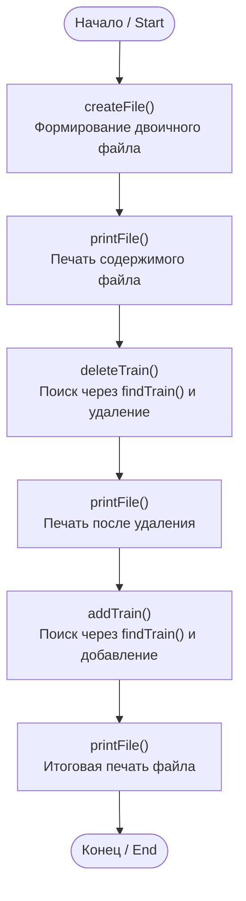

# Отчет по лабораторной работе №8

<div align="center">

# 🎓 МИНИСТЕРСТВО ОБРАЗОВАНИЯ И НАУКИ РОССИЙСКОЙ ФЕДЕРАЦИИ
### Кафедра Автоматизированных систем управления (АСУ)

---

## 👤 Студенческая Визитная Карточка

| 📝 Личные данные студента | 🔍 Официальная информация |
| :--- | :--- |
| **ФИО Студента** | <span style="color: #238636;"><b>[Мухаммад Майя]</b></span> |
| **Номер группы** | <span style="color: #1f6feb;"><b>[ИВТ-26-1б]</b></span> |
| **Специальность** | Инженерная информатика (АСУ) |
| **Дисциплина** | Программирование на языке С++ |

</div>

---

## 📌 Постановка задачи

**Блоковый ввод-вывод:**
Сформировать двоичный файл из элементов заданной в варианте структуры («Поезд»: номер поезда, пункт назначения, время отправления, количество вагонов), распечатать его содержимое, выполнить удаление и добавление элементов в соответствии со своим вариантом, используя для поиска удаляемых или добавляемых элементов отдельную функцию. Формирование, печать, добавление и удаление элементов оформить в виде функций. Предусмотреть сообщения об ошибках при открытии файла и выполнении операций ввода/вывода.

> 🌐 **[EN]** Task setup (Block I/O): Create a binary file of elements of the specified structure ("Train": train number, destination, departure time, number of carriages), print its contents, delete and add elements using a separate search function. Implement creation, printing, addition, and deletion as functions, including error handling for file opening and I/O operations.
> 🌐 **[AR]** صياغة المسألة (الإدخال والإخراج الكتلي): تكوين ملف ثنائي من عناصر الهيكل المحدد («القطار»: رقم القطار، وجهة السفر، وقت المغادرة، عدد العربات)، طباعة محتوياته، وتنفيذ عمليات الحذف والإضافة باستخدام دالة بحث مستقلة، مع صياغة كل عملية في دالة منفصلة وتوفير رسائل خطأ عند فتح الملف أو تنفيذ عمليات الإدخال والإخراج.

---

## 🗺️ Блок-схема алгоритма программы (Flowchart)

<div align="center">



</div>

---

## 🧩 Пошаговый разбор кода (Step-by-Step Code Explanation)

### 🔹 Шаг 1: Подключение библиотек (Header Files)

```cpp
#include <iostream>
#include <fstream>
#include <cstring>
#include <iomanip>

using namespace std;
```

Подключаются библиотеки `iostream` (консольный ввод-вывод), `fstream` (работа с файловыми потоками `ifstream` и `ofstream`), `cstring` (работа со строками в стиле C) и `iomanip` (форматирование вывода таблиц с помощью `setw`).

> 🌐 **[EN]** Includes `iostream` (console I/O), `fstream` (file streams `ifstream` and `ofstream`), `cstring` (C-style strings), and `iomanip` (table output formatting using `setw`).
> 🌐 **[AR]** استدعاء مكتبات `iostream` (للإدخال والإخراج عبر الشاشة)، و `fstream` (للتعامل مع الملفات)، و `cstring` (للنصوص)، و `iomanip` (لتنسيق الجداول باستخدام `setw`).

---

### 🔹 Шаг 2: Объявление структуры «Поезд» (`struct Train`)

```cpp
struct Train
{
    int number;              // رقم القطار (номер поезда)
    char destination[50];    // وجهة السفر (пункт назначения)
    char departureTime[20];  // وقت المغادرة (время отправления)
    int carriages;           // عدد العربات (количество вагонов)
};
```

Создаётся структура `Train` с четырьмя полями по условию варианта. Для текстовых полей используются фиксированные массивы символов `char[]`, так как при двоичной блоковой записи (`write`/`read`) структура копируется в файл побайтово.

> 🌐 **[EN]** Defines `struct Train` with the four required fields. Fixed-size character arrays (`char[]`) are used for text fields because binary block I/O (`write`/`read`) copies raw bytes directly from memory.
> 🌐 **[AR]** تعريف الهيكل `Train` بالحقول الأربعة المطلوبة. تم استخدام مصفوفات أحرف ثابتة (`char[]`) للنصوص لأن الكتابة والقراءة الكتلية تنسخ البايتات مباشرة من الذاكرة.

---

### 🔹 Шаг 3: Вспомогательная функция ввода данных `inputTrain()`

```cpp
Train inputTrain()
{
    Train t;
    cout << "  -> Enter train number (e.g., 102): ";
    cin >> t.number;
    cin.ignore();

    cout << "  -> Enter destination (e.g., Perm): ";
    cin.getline(t.destination, 50);

    cout << "  -> Enter departure time (e.g., 14:30): ";
    cin.getline(t.departureTime, 20);

    cout << "  -> Enter number of carriages (e.g., 12): ";
    cin >> t.carriages;
    return t;
}
```

Функция запрашивает у пользователя данные об одном поезде и заполняет поля структуры `Train`. Вызов `cin.ignore()` очищает буфер ввода от символа новой строки `\n` после чтения числа, чтобы функция `cin.getline()` корректно считала текстовые строки с пробелами.

> 🌐 **[EN]** Prompts the user for one train's details and populates a `Train` structure. `cin.ignore()` clears the leftover newline `\n` from the input buffer after reading a number so `cin.getline()` reads text properly.
> 🌐 **[AR]** تطلب الدالة بيانات قطار واحد من المستخدم وتخزنها في هيكل `Train`. يقوم الأمر `cin.ignore()` بتنظيف الذاكرة المؤقتة من رمز السطر الجديد بعد قراءة الرقم حتى تعمل `cin.getline()` بشكل صحيح.

---

### 🔹 Шаг 4: Функция формирования двоичного файла `createFile()`

```cpp
void createFile(const char* filename)
{
    ofstream outFile(filename, ios::binary);
    if (!outFile.is_open())
    {
        cerr << "[ERROR] Failed to open file '" << filename << "' for writing!\n";
        return;
    }

    int count;
    cout << "How many trains do you want to add initially?\n> ";
    cin >> count;

    for (int i = 0; i < count; ++i)
   {
        cout << "\n[Train #" << (i + 1) << "]\n";
        Train t = inputTrain();
        outFile.write(reinterpret_cast<const char*>(&t), sizeof(Train));

        if (outFile.fail())
        {
            cerr << "[ERROR] Write operation failed!\n";
            outFile.close();
            return;
        }
    }

    outFile.close();
    cout << "\n[SUCCESS] Binary file '" << filename << "' created successfully!\n";
}
```

Функция открывает файл в двоичном режиме (`ios::binary`) и проверяет успешность открытия (`!outFile.is_open()`). В цикле запрашиваются данные каждого поезда и записываются в файл единым блоком размером `sizeof(Train)` через метод `outFile.write()` с проверкой ошибки записи `outFile.fail()`.

> 🌐 **[EN]** Opens the file in binary mode (`ios::binary`) and verifies it opened (`!outFile.is_open()`). Inside a loop, each train record is written as a single block of `sizeof(Train)` bytes via `outFile.write()`, checking `outFile.fail()` for write errors.
> 🌐 **[AR]** تفتح الدالة الملف في الوضع الثنائي (`ios::binary`) وتتحقق من نجاح الفتح (`!outFile.is_open()`). داخل الحلقة التكرارية يتم إدخال بيانات كل قطار وكتابتها ككتلة واحدة بحجم `sizeof(Train)` عبر `outFile.write()` مع فحص أخطاء الكتابة `outFile.fail()`.

---

### 🔹 Шаг 5: Функция печати содержимого файла `printFile()`

```cpp
void printFile(const char* filename)
{
    ifstream inFile(filename, ios::binary);
    if (!inFile.is_open())
    {
        cerr << "[ERROR] Failed to open file '" << filename << "' for reading!\n";
        return;
    }

    cout << "\n====================================================================\n";
    cout << left << setw(12) << "Train No."
         << setw(25) << "Destination"
         << setw(18) << "Departure"
         << setw(12) << "Carriages" << "\n";
    cout << "--------------------------------------------------------------------\n";

    Train t;
    bool isEmpty = true;

    while (inFile.read(reinterpret_cast<char*>(&t), sizeof(Train)))
    {
        isEmpty = false;
        cout << left << setw(12) << t.number
             << setw(25) << t.destination
             << setw(18) << t.departureTime
             << setw(12) << t.carriages << "\n";
    }

    if (inFile.bad())
    {
        cerr << "[ERROR] Read operation failed!\n";
    } else if (isEmpty)
    {
        cout << "The file is currently empty.\n";
    }
    cout << "====================================================================\n";

    inFile.close();
}
```

Функция открывает файл для двоичного чтения и в цикле `while` считывает записи размером `sizeof(Train)` с помощью `inFile.read()`, выводя их в отформатированную таблицу. Если во время чтения произошёл сбой, срабатывает проверка `inFile.bad()`.

> 🌐 **[EN]** Opens the file for binary reading and uses `inFile.read()` in a `while` loop to read `sizeof(Train)` blocks, printing them in a formatted table. `inFile.bad()` checks for read errors.
> 🌐 **[AR]** تفتح الدالة الملف للقراءة الثنائية وتستخدم `inFile.read()` داخل حلقة `while` لقراءة الكتل بحجم `sizeof(Train)` وعرضها في جدول منسق، مع التحقق من أخطاء القراءة عبر `inFile.bad()`.

---

### 🔹 Шаг 6: Функция поиска элемента `findTrain()`

```cpp
bool findTrain(const char* filename, int targetNumber, Train& foundTrain)
{
    ifstream inFile(filename, ios::binary);
    if (!inFile.is_open())
    {
        cerr << "[ERROR] Failed to open file for searching!\n";
        return false;
    }

    Train t;
    while (inFile.read(reinterpret_cast<char*>(&t), sizeof(Train)))
    {
        if (t.number == targetNumber)
        {
            foundTrain = t;
            inFile.close();
            return true;
        }
    }

    inFile.close();
    return false;
}
```

Отдельная функция поиска последовательно считывает блоки из двоичного файла и сравнивает `t.number` с искомым номером `targetNumber`. Если поезд найден, она сохраняет его в `foundTrain`, закрывает файл и возвращает `true`.

> 🌐 **[EN]** A standalone search function sequentially reads blocks from the binary file and compares `t.number` with `targetNumber`. If found, it copies the record to `foundTrain`, closes the file, and returns `true`.
🌐 [AR] دالة بحث مستقلة تقرأ السجلات بالتتابع من الملف الثنائي وتقارن رقم القطار t.number مع الرقم المطلوب targetNumber؛ وإذا وجدته تحفظه في foundTrain وتُغلق الملف وتُرجع true.

🔹 Шаг 7: Функция удаления элемента deleteTrain()

```cpp
void deleteTrain(const char* filename, int targetNumber)
{
    Train dummy;
    if (!findTrain(filename, targetNumber, dummy))
    {
        cout << "[INFO] Train #" << targetNumber << " was not found in the file.\n";
        return;
    }

    ifstream inFile(filename, ios::binary);
    ofstream tempFile("temp.dat", ios::binary);

    if (!inFile.is_open() || !tempFile.is_open())
    {
        cerr << "[ERROR] File error during deletion process!\n";
        return;
    }

    Train t;
    while (inFile.read(reinterpret_cast<char*>(&t), sizeof(Train)))
    {
        if (t.number != targetNumber)
       {
            tempFile.write(reinterpret_cast<const char*>(&t), sizeof(Train));
            if (tempFile.fail())
            {
                cerr << "[ERROR] Write error while copying data!\n";
                inFile.close();
                tempFile.close();
                return;
            }
        }
    }

    inFile.close();
    tempFile.close();

    remove(filename);
    rename("temp.dat", filename);

    cout << "[SUCCESS] Train #" << targetNumber << " deleted successfully!\n";
}
```
Сначала вызывается функция поиска findTrain(). Если поезд найден, открываются исходный файл и временный файл temp.dat. Все записи, кроме удаляемой (t.number != targetNumber), копируются в temp.dat, после чего исходный файл удаляется (remove), а временный переименовывается (rename).
🌐 [EN] First calls findTrain() to verify the train exists. If found, it copies all records except targetNumber into temp.dat, deletes the original file via remove(), and renames temp.dat to replace it.
🌐 [AR] تستدعي الدالة أولاً findTrain() للتأكد من وجود القطار؛ وإذا وُجد تنسخ جميع السجلات ما عدا القطار المطلوب حذفه إلى ملف مؤقت temp.dat، ثم تحذف الملف الأصلي (remove) وتعيد تسمية الملف المؤقت (rename).

🔹 Шаг 8: Функция добавления элемента addTrain()
```cpp
void addTrain(const char* filename)
{
    cout << "\n[Add New Train]\n";
    Train newTrain = inputTrain();

    int afterNumber;
    cout << "Enter train number after which to insert (or 0 to append at the end):\n> ";
    cin >> afterNumber;

    if (afterNumber == 0)
       {
        ofstream outFile(filename, ios::binary | ios::app);
        if (!outFile.is_open())
        {
            cerr << "[ERROR] Failed to open file for appending!\n";
            return;
        }
        outFile.write(reinterpret_cast<const char*>(&newTrain), sizeof(Train));
        if (outFile.fail())
        {
            cerr << "[ERROR] Write error while appending!\n";
        }
        else
        {
            cout << "[SUCCESS] New train appended to the end of the file!\n";
        }
        outFile.close();
        return;
    }

    Train dummy;
    if (!findTrain(filename, afterNumber, dummy))
    {
        cout << "[INFO] Reference Train #" << afterNumber << " not found. Appending to the end instead.\n";
        ofstream outFile(filename, ios::binary | ios::app);
        if (!outFile.is_open())
        {
            cerr << "[ERROR] Failed to open file for appending!\n";
            return;
        }
        outFile.write(reinterpret_cast<const char*>(&newTrain), sizeof(Train));
        outFile.close();
        return;
    }

    ifstream inFile(filename, ios::binary);
    ofstream tempFile("temp.dat", ios::binary);

    if (!inFile.is_open() || !tempFile.is_open())
    {
        cerr << "[ERROR] File error during insertion process!\n";
        return;
    }

    Train t;
    bool inserted = false;
    while (inFile.read(reinterpret_cast<char*>(&t), sizeof(Train)))
    {
        tempFile.write(reinterpret_cast<const char*>(&t), sizeof(Train));
        if (t.number == afterNumber && !inserted)
        {
            tempFile.write(reinterpret_cast<const char*>(&newTrain), sizeof(Train));
            inserted = true;
        }
    }

    inFile.close();
    tempFile.close();

    remove(filename);
    rename("temp.dat", filename);

    cout << "[SUCCESS] New train inserted after Train #" << afterNumber << "!\n";
}

```
Функция считывает данные нового поезда и номер опорного поезда (afterNumber). Если введён 0, запись добавляется в конец файла в режиме ios::app. Иначе с помощью findTrain() проверяется наличие опорного поезда, и при копировании блоков в temp.dat новая запись вставляется сразу после найденного элемента.
🌐 [EN] Reads the new train details and the target afterNumber. If 0 is entered, it appends to the end via ios::app. Otherwise, it verifies afterNumber using findTrain() and inserts newTrain immediately after it while copying blocks to temp.dat.
🌐 [AR] تقرأ الدالة بيانات القطار الجديد ورقم القطار المرجعي (afterNumber). إذا أدخل المستخدم 0 يُضاف القطار في نهاية الملف بوضع ios::app، وإلا تتحقق الدالة من وجود القطار المرجعي عبر findTrain() وتُدرج القطار الجديد بعده مباشرة أثناء النسخ إلى temp.dat.

🔹 Шаг 9: Главная функция main()
```cpp
int main()
{
    const char* filename = "trains.dat";

    cout << "=========================================================\n";
    cout << "       LABORATORY WORK #8: BINARY FILE OPERATIONS        \n";
    cout << "=========================================================\n\n";

    createFile(filename);
    printFile(filename);

    int delNum;
    cout << "\nEnter the train number you want to DELETE:\n> ";
    cin >> delNum;
    deleteTrain(filename, delNum);
    printFile(filename);

    addTrain(filename);
    printFile(filename);

    return 0;
}

```
В функции main() задаётся имя двоичного файла "trains.dat" и последовательно вызываются все разработанные функции: формирование файла, его печать, удаление указанного поезда с повторной печатью, а затем добавление нового поезда и итоговый вывод содержимого.
🌐 [EN] Sets the binary filename "trains.dat" and sequentially invokes all functions: file creation, initial printing, deleting a user-specified train with updated printing, and adding a new train with final printing.
🌐 [AR] تحدد الدالة الرئيسية اسم الملف الثنائي "trains.dat" وتستدعي جميع الدوال بالترتيب: إنشاء الملف، طباعته، حذف القطار المطلوب ثم الطباعة مجدداً، وأخيراً إضافة قطار جديد وطباعة الجدول النهائي.


💻 Полный исходный код программы (Full Source Code)

```cpp
#include <iostream>
#include <fstream>
#include <cstring>
#include <iomanip>

using namespace std;

// تعريف هيكل "القطار" (Структура "Поезд") بالحقول الأربعة المطلوبة
struct Train
{
    int number;              // رقم القطار (номер поезда)
    char destination[50];    // وجهة السفر (пункт назначения)
    char departureTime[20];  // وقت المغادرة (время отправления)
    int carriages;           // عدد العربات (количество вагонов)
};

// دالة مساعدة لإدخال بيانات قطار واحد
Train inputTrain()
{
    Train t;
    cout << "  -> Enter train number (e.g., 102): ";
    cin >> t.number;
    cin.ignore(); // تنظيف ذاكرة الإدخال المؤقتة قبل قراءة النصوص

    cout << "  -> Enter destination (e.g., Perm): ";
    cin.getline(t.destination, 50);

    cout << "  -> Enter departure time (e.g., 14:30): ";
    cin.getline(t.departureTime, 20);

    cout << "  -> Enter number of carriages (e.g., 12): ";
    cin >> t.carriages;
    return t;
}

// 1. دالة تكوين الملف الثنائي (Формирование двоичного файла)
void createFile(const char* filename)
{
    ofstream outFile(filename, ios::binary);
    if (!outFile.is_open())
    {
        cerr << "[ERROR] Failed to open file '" << filename << "' for writing!\n";
        return;
    }

    int count;
    cout << "How many trains do you want to add initially?\n> ";
    cin >> count;

    for (int i = 0; i < count; ++i)
    {
        cout << "\n[Train #" << (i + 1) << "]\n";
        Train t = inputTrain();
        outFile.write(reinterpret_cast<const char*>(&t), sizeof(Train));

        if (outFile.fail())
        {
            cerr << "[ERROR] Write operation failed!\n";
            outFile.close();
            return;
        }
    }

    outFile.close();
    cout << "\n[SUCCESS] Binary file '" << filename << "' created successfully!\n";
}

// 2. دالة طباعة محتويات الملف (Печать содержимого файла)
void printFile(const char* filename)
{
    ifstream inFile(filename, ios::binary);
    if (!inFile.is_open())
    {
        cerr << "[ERROR] Failed to open file '" << filename << "' for reading!\n";
        return;
    }

    cout << "\n====================================================================\n";
    cout << left << setw(12) << "Train No."
         << setw(25) << "Destination"
         << setw(18) << "Departure"
         << setw(12) << "Carriages" << "\n";
    cout << "--------------------------------------------------------------------\n";

    Train t;
    bool isEmpty = true;

    while (inFile.read(reinterpret_cast<char*>(&t), sizeof(Train)))
    {
        isEmpty = false;
        cout << left << setw(12) << t.number
             << setw(25) << t.destination
             << setw(18) << t.departureTime
             << setw(12) << t.carriages << "\n";
    }

    if (inFile.bad())
    {
        cerr << "[ERROR] Read operation failed!\n";
    }
    else if (isEmpty)
    {
        cout << "The file is currently empty.\n";
    }
    cout << "====================================================================\n";

    inFile.close();
}

// 3. دالة البحث عن عنصر برقم القطار (Функция поиска элемента)
bool findTrain(const char* filename, int targetNumber, Train& foundTrain)
{
    ifstream inFile(filename, ios::binary);
    if (!inFile.is_open())
    {
        cerr << "[ERROR] Failed to open file for searching!\n";
        return false;
    }

    Train t;
    while (inFile.read(reinterpret_cast<char*>(&t), sizeof(Train)))
   {
        if (t.number == targetNumber)
        {
            foundTrain = t;
            inFile.close();
            return true;
        }
    }

    inFile.close();
    return false;
}

// 4. دالة حذف عنصر باستخدام دالة البحث (Удаление элемента)
void deleteTrain(const char* filename, int targetNumber)
{
    Train dummy;
    if (!findTrain(filename, targetNumber, dummy))
    {
        cout << "[INFO] Train #" << targetNumber << " was not found in the file.\n";
        return;
    }

    ifstream inFile(filename, ios::binary);
    ofstream tempFile("temp.dat", ios::binary);

    if (!inFile.is_open() || !tempFile.is_open())
    {
        cerr << "[ERROR] File error during deletion process!\n";
        return;
    }

    Train t;
    while (inFile.read(reinterpret_cast<char*>(&t), sizeof(Train)))
   {
        if (t.number != targetNumber)
        {
            tempFile.write(reinterpret_cast<const char*>(&t), sizeof(Train));
            if (tempFile.fail())
            {
                cerr << "[ERROR] Write error while copying data!\n";
                inFile.close();
                tempFile.close();
                return;
            }
        }
    }

    inFile.close();
    tempFile.close();

    remove(filename);
    rename("temp.dat", filename);

    cout << "[SUCCESS] Train #" << targetNumber << " deleted successfully!\n";
}

// 5. دالة إضافة عنصر باستخدام دالة البحث (Добавление элемента)
void addTrain(const char* filename)
{
    cout << "\n[Add New Train]\n";
    Train newTrain = inputTrain();

    int afterNumber;
    cout << "Enter train number after which to insert (or 0 to append at the end):\n> ";
    cin >> afterNumber;

    if (afterNumber == 0)
   {
        ofstream outFile(filename, ios::binary | ios::app);
        if (!outFile.is_open())
        {
            cerr << "[ERROR] Failed to open file for appending!\n";
            return;
        }
        outFile.write(reinterpret_cast<const char*>(&newTrain), sizeof(Train));
        if (outFile.fail())
        {
            cerr << "[ERROR] Write error while appending!\n";
        }
        else
        {
            cout << "[SUCCESS] New train appended to the end of the file!\n";
        }
        outFile.close();
        return;
    }

    Train dummy;
    if (!findTrain(filename, afterNumber, dummy))
    {
        cout << "[INFO] Reference Train #" << afterNumber << " not found. Appending to the end instead.\n";
        ofstream outFile(filename, ios::binary | ios::app);
        if (!outFile.is_open())
        {
            cerr << "[ERROR] Failed to open file for appending!\n";
            return;
        }
        outFile.write(reinterpret_cast<const char*>(&newTrain), sizeof(Train));
        outFile.close();
        return;
    }

    ifstream inFile(filename, ios::binary);
    ofstream tempFile("temp.dat", ios::binary);

    if (!inFile.is_open() || !tempFile.is_open())
    {
        cerr << "[ERROR] File error during insertion process!\n";
        return;
    }

    Train t;
    bool inserted = false;
    while (inFile.read(reinterpret_cast<char*>(&t), sizeof(Train)))
   {
        tempFile.write(reinterpret_cast<const char*>(&t), sizeof(Train));
        if (t.number == afterNumber && !inserted)
        {
            tempFile.write(reinterpret_cast<const char*>(&newTrain), sizeof(Train));
            inserted = true;
        }
    }

    inFile.close();
    tempFile.close();

    remove(filename);
    rename("temp.dat", filename);

    cout << "[SUCCESS] New train inserted after Train #" << afterNumber << "!\n";
}

int main()
{
    const char* filename = "trains.dat";

    cout << "=========================================================\n";
    cout << "       LABORATORY WORK #8: BINARY FILE OPERATIONS        \n";
    cout << "=========================================================\n\n";

    // 1. تكوين الملف وطباعته
    createFile(filename);
    printFile(filename);

    // 2. البحث والحذف
    int delNum;
    cout << "\nEnter the train number you want to DELETE:\n> ";
    cin >> delNum;
    deleteTrain(filename, delNum);
    printFile(filename);

    // 3. البحث والإضافة
    addTrain(filename);
    printFile(filename);

    return 0;
}

```

🖥️ Пример работы программы (Консоль)

Показать код
Скачать диаграмму в формате SVG
```text
=========================================================
       LABORATORY WORK #8: BINARY FILE OPERATIONS        
=========================================================

How many trains do you want to add initially?
> 2

[Train #1]
  -> Enter train number (e.g., 102): 101
  -> Enter destination (e.g., Perm): Moscow
  -> Enter departure time (e.g., 14:30): 08:30
  -> Enter number of carriages (e.g., 12): 14

[Train #2]
  -> Enter train number (e.g., 102): 202
  -> Enter destination (e.g., Perm): Perm
  -> Enter departure time (e.g., 14:30): 19:45
  -> Enter number of carriages (e.g., 12): 10

[SUCCESS] Binary file 'trains.dat' created successfully!

====================================================================
Train No.   Destination              Departure         Carriages   
--------------------------------------------------------------------
101         Moscow                   08:30             14          
202         Perm                     19:45             10          
====================================================================

Enter the train number you want to DELETE:
> 101
[SUCCESS] Train #101 deleted successfully!

====================================================================
Train No.   Destination              Departure         Carriages   
--------------------------------------------------------------------
202         Perm                     19:45             10          
====================================================================

[Add New Train]
  -> Enter train number (e.g., 102): 303
  -> Enter destination (e.g., Perm): Kazan
  -> Enter departure time (e.g., 14:30): 22:15
  -> Enter number of carriages (e.g., 12): 16
Enter train number after which to insert (or 0 to append at the end):
> 202
[SUCCESS] New train inserted after Train #202!

====================================================================
Train No.   Destination              Departure         Carriages   
--------------------------------------------------------------------
202         Perm                     19:45             10          
303         Kazan                    22:15             16          
====================================================================
