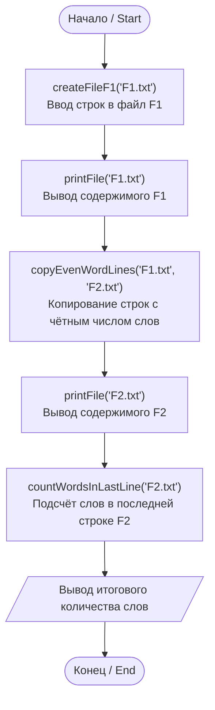

# Отчет по лабораторной работе №9

<div align="center">

# 🎓 МИНИСТЕРСТВО ОБРАЗОВАНИЯ И НАУКИ РОССИЙСКОЙ ФЕДЕРАЦИИ
### Кафедра Автоматизированных систем управления (АСУ)

---

## 👤 Студенческая Визитная Карточка

| 📝 Личные данные студента | 🔍 Официальная информация |
| :--- | :--- |
| **ФИО Студента** | <span style="color: #238636;"><b>[Мухаммад Майя]</b></span> |
| **Номер группы** | <span style="color: #1f6feb;"><b>[ИВТ-26-1б]</b></span> |
| **Специальность** | Инженерная информатика (АСУ) |
| **Дисциплина** | Программирование на языке С++ |

</div>

---

## 📌 Постановка задачи

**Строковый ввод-вывод (Вариант 27):**
1. Скопировать из файла `F1` в файл `F2` все строки, в которых количество слов чётно.
2. Определить количество слов в последней строке файла `F2`.

> 🌐 **[EN]** Task setup (String File I/O — Variant 27): 1) Copy from file `F1` to file `F2` all lines that contain an even number of words. 2) Determine the number of words in the last line of file `F2`.
> 🌐 **[AR]** صياغة المسألة (الإدخال والإخراج النصي للملفات — النموذج 27): 1) نسخ جميع الأسطر التي تحتوي على عدد زوجي من الكلمات من الملف `F1` إلى الملف `F2`. 2) تحديد عدد الكلمات في السطر الأخير من الملف `F2`.

---

## 🗺️ Блок-схема алгоритма программы (Flowchart)

<div align="center">



</div>

---

## 🧩 Пошаговый разбор кода (Step-by-Step Code Explanation)

### 🔹 Шаг 1: Подключение библиотек (Header Files)

```cpp
#include <iostream>
#include <fstream>
#include <sstream>
#include <string>

using namespace std;
```

Подключаются библиотеки `iostream` (консольный ввод-вывод), `fstream` (работа с текстовыми файлами `ifstream` и `ofstream`), `sstream` (строковый поток `stringstream` для разбиения строки на слова) и `string` (работа со строками).

> 🌐 **[EN]** Includes `iostream` (console I/O), `fstream` (text file streams `ifstream` and `ofstream`), `sstream` (`stringstream` for splitting lines into words), and `string`.
> 🌐 **[AR]** استدعاء مكتبات `iostream` (للإدخال والإخراج عبر الشاشة)، و `fstream` (للتعامل مع الملفات النصية)، و `sstream` (لتقسيم السطر إلى كلمات منفصلة)، و `string` (للتعامل مع النصوص).

---

### 🔹 Шаг 2: Функция подсчёта слов в строке `countWords()`

```cpp
int countWords(const string& line) {
    stringstream ss(line); // تقسيم السطر تلقائياً عند كل مسافة
    string word;
    int count = 0;

    while (ss >> word) {
        count++;
    }
    return count;
}
```

Строка передаётся в строковый поток `stringstream ss(line)`. Оператор извлечения `ss >> word` автоматически пропускает все пробелы и считывает каждое отдельное слово в переменную `word`, увеличивая счётчик `count` на 1.

> 🌐 **[EN]** Passes the line into a `stringstream ss(line)`. The extraction operator `ss >> word` automatically skips whitespace and reads each individual word into `word`, incrementing `count`.
> 🌐 **[AR]** يتم تمرير السطر إلى الكائن `stringstream ss(line)`، حيث يقوم عامل الاستخراج `ss >> word` بتجاهل المسافات وقراءة كل كلمة على حدة وزيادة العداد `count` بمقدار 1.

---

### 🔹 Шаг 3: Функция формирования исходного файла `createFileF1()`

```cpp
void createFileF1(const string& filename) {
    ofstream outFile(filename);
    if (!outFile.is_open()) {
        cerr << "[ERROR] Failed to create file '" << filename << "'!\n";
        return;
    }

    int lineCount;
    cout << "How many lines do you want to write into " << filename << "?\n> ";
    cin >> lineCount;
    cin.ignore(); // تنظيف ذاكرة الإدخال المؤقتة بعد قراءة الرقم

    cout << "\nEnter the lines one by one:\n";
    for (int i = 0; i < lineCount; ++i) {
        string line;
        cout << "Line " << (i + 1) << "> ";
        getline(cin, line);
        outFile << line << "\n";
    }

    outFile.close();
    cout << "\n[SUCCESS] File '" << filename << "' created successfully!\n";
}
```

Функция создаёт текстовый файл `F1.txt`, запрашивает количество строк и в цикле считывает каждую строку с клавиатуры с помощью `getline(cin, line)`, записывая её в файл. Вызов `cin.ignore()` очищает символ переноса строки после ввода числа.

> 🌐 **[EN]** Creates `F1.txt`, prompts for the number of lines, and reads each line via `getline(cin, line)` inside a loop, writing it to the file. `cin.ignore()` clears the leftover newline after reading `lineCount`.
> 🌐 **[AR]** تنشئ الدالة الملف `F1.txt`، وتطلب عدد الأسطر ثم تقرأ كل سطر من المستخدم عبر `getline(cin, line)` وتكتبه في الملف، مع استخدام `cin.ignore()` لتنظيف ذاكرة الإدخال المؤقتة.

---

### 🔹 Шаг 4: Функция вывода содержимого файла `printFile()`

```cpp
void printFile(const string& filename) {
    ifstream inFile(filename);
    if (!inFile.is_open()) {
        cerr << "[ERROR] Failed to open file '" << filename << "' for reading!\n";
        return;
    }

    cout << "\n---------------------------------------------------------\n";
    cout << "Contents of '" << filename << "':\n";
    cout << "---------------------------------------------------------\n";

    string line;
    int lineNum = 0;
    while (getline(inFile, line)) {
        lineNum++;
        cout << "[" << lineNum << "] " << line << "  (Words: " << countWords(line) << ")\n";
    }

    if (lineNum == 0) {
        cout << "(File is empty)\n";
    }
    cout << "---------------------------------------------------------\n";

    inFile.close();
}
```

Функция построчно считывает файл с помощью `while (getline(inFile, line))` и выводит каждую строку на экран с указанием её номера и количества слов в ней.

> 🌐 **[EN]** Reads the file line by line using `while (getline(inFile, line))` and prints each line along with its line number and word count.
> 🌐 **[AR]** تقرأ الدالة الملف سطراً بسطر باستخدام `while (getline(inFile, line))` وتطبع كل سطر مع رقمه وعدد الكلمات الموجودة فيه.

---

### 🔹 Шаг 5: Функция копирования строк с чётным числом слов `copyEvenWordLines()`

```cpp
void copyEvenWordLines(const string& fileF1, const string& fileF2) {
    ifstream inFile(fileF1);
    ofstream outFile(fileF2);

    if (!inFile.is_open() || !outFile.is_open()) {
        cerr << "[ERROR] Failed to open files during copy operation!\n";
        return;
    }

    string line;
    int copiedCount = 0;

    while (getline(inFile, line)) {
        int words = countWords(line);
        // التحقق أن السطر غير فارغ وأن عدد كلماته زوجي
        if (words > 0 && words % 2 == 0) {
            outFile << line << "\n";
            copiedCount++;
        }
    }

    inFile.close();
    outFile.close();
    cout << "\n[SUCCESS] Copied " << copiedCount << " line(s) with an even number of words to '" << fileF2 << "'.\n";
}
```

Открываются оба файла: `F1.txt` для чтения и `F2.txt` для записи. Для каждой прочитанной строки вычисляется количество слов `words`. Если строка не пустая и остаток от деления на 2 равен нулю (`words > 0 && words % 2 == 0`), строка записывается в `F2.txt`.

> 🌐 **[EN]** Opens `F1.txt` for reading and `F2.txt` for writing. For each line, `countWords(line)` is evaluated; if non-empty and even (`words > 0 && words % 2 == 0`), the line is written to `F2.txt`.
> 🌐 **[AR]** تفتح الدالة الملف `F1.txt` للقراءة والملف `F2.txt` للكتابة؛ وتفحص عدد كلمات كل سطر، فإذا كان أكبر من صفر وزوجياً (`words % 2 == 0`) تنسخ السطر إلى `F2.txt`.

---

### 🔹 Шаг 6: Функция определения числа слов в последней строке `countWordsInLastLine()`

```cpp
int countWordsInLastLine(const string& filename) {
    ifstream inFile(filename);
    if (!inFile.is_open()) {
        cerr << "[ERROR] Failed to open file '" << filename << "'!\n";
        return -1;
    }

    string line, lastLine;
    bool hasLines = false;

    while (getline(inFile, line)) {
        if (!line.empty()) {
            lastLine = line;
            hasLines = true;
        }
    }

    inFile.close();

    if (!hasLines) {
        return 0; // الملف فارغ
    }

    return countWords(lastLine);
}
```

Функция считывает все непустые строки из файла `F2.txt`, перезаписывая переменную `lastLine` на каждой итерации. После окончания цикла в `lastLine` остаётся последняя строка файла, для которой вызывается `countWords(lastLine)`.

> 🌐 **[EN]** Reads all non-empty lines from `F2.txt`, updating `lastLine` on every iteration. After the loop finishes, `lastLine` holds the final line of the file, and `countWords(lastLine)` returns its word count.
> 🌐 **[AR]** تقرأ الدالة جميع الأسطر غير الفارغة من الملف `F2.txt` وتحدث المتغير `lastLine` في كل دورة، بحيث يحتفظ في النهاية بالسطر الأخير فقط، ثم تُرجع عدد كلماته عبر `countWords(lastLine)`.

---

### 🔹 Шаг 7: Главная функция `main()`

```cpp
int main() {
    const string fileF1 = "F1.txt";
    const string fileF2 = "F2.txt";

    cout << "=========================================================\n";
    cout << "     LABORATORY WORK #9: STRING FILE I/O (Variant 27)    \n";
    cout << "=========================================================\n\n";

    createFileF1(fileF1);
    printFile(fileF1);

    copyEvenWordLines(fileF1, fileF2);
    printFile(fileF2);

    int lastLineWords = countWordsInLastLine(fileF2);
    cout << "\n>>> Result: Number of words in the last line of '" << fileF2 << "' = " << lastLineWords << "\n";
    cout << "=========================================================\n";

    return 0;
}
```

В `main()` последовательно выполняются все этапы задачи: создание `F1.txt`, его печать, копирование нужных строк в `F2.txt`, печать `F2.txt` и вывод количества слов в его последней строке.
🌐 [EN] main() executes all steps sequentially: creating F1.txt, printing it, copying even-word lines into F2.txt, printing F2.txt, and displaying the word count of its last line.
🌐 [AR] تنفذ الدالة الرئيسية main() جميع الخطوات بالتتابع: إنشاء الملف F1.txt، وطباعته، ونسخ الأسطر المطلوبة إلى F2.txt، وطباعة F2.txt، ثم عرض عدد الكلمات في سطره الأخير.


💻 Полный исходный код программы (Full Source Code)
```cpp

#include <iostream>
#include <fstream>
#include <sstream>
#include <string>

using namespace std;

// دالة مساعدة لحساب عدد الكلمات في سطر نصي واحد
int countWords(const string& line)
{
    stringstream ss(line); // تقسيم السطر تلقائياً عند كل مسافة
    string word;
    int count = 0;

    while (ss >> word)
    {
        count++;
    }
    return count;
}

// 1. دالة تكوين الملف الأول F1.txt من مدخلات المستخدم
void createFileF1(const string& filename)
{
    ofstream outFile(filename);
    if (!outFile.is_open())
    {
        cerr << "[ERROR] Failed to create file '" << filename << "'!\n";
        return;
    }

    int lineCount;
    cout << "How many lines do you want to write into " << filename << "?\n> ";
    cin >> lineCount;
    cin.ignore(); // تنظيف ذاكرة الإدخال المؤقتة بعد قراءة الرقم

    cout << "\nEnter the lines one by one:\n";
    for (int i = 0; i < lineCount; ++i)
    {
        string line;
        cout << "Line " << (i + 1) << "> ";
        getline(cin, line);
        outFile << line << "\n";
    }

    outFile.close();
    cout << "\n[SUCCESS] File '" << filename << "' created successfully!\n";
}

// 2. دالة طباعة محتويات أي ملف نصي مع توضيح عدد كلمات كل سطر
void printFile(const string& filename)
{
    ifstream inFile(filename);
    if (!inFile.is_open())
    {
        cerr << "[ERROR] Failed to open file '" << filename << "' for reading!\n";
        return;
    }

    cout << "\n---------------------------------------------------------\n";
    cout << "Contents of '" << filename << "':\n";
    cout << "---------------------------------------------------------\n";

    string line;
    int lineNum = 0;
    while (getline(inFile, line))
    {
        lineNum++;
        cout << "[" << lineNum << "] " << line << "  (Words: " << countWords(line) << ")\n";
    }

    if (lineNum == 0)
    {
        cout << "(File is empty)\n";
    }
    cout << "---------------------------------------------------------\n";

    inFile.close();
}

// 3. دالة نسخ الأسطر ذات العدد الزوجي من الكلمات من F1 إلى F2
void copyEvenWordLines(const string& fileF1, const string& fileF2)
{
    ifstream inFile(fileF1);
    ofstream outFile(fileF2);

    if (!inFile.is_open() || !outFile.is_open())
    {
        cerr << "[ERROR] Failed to open files during copy operation!\n";
        return;
    }

    string line;
    int copiedCount = 0;

    while (getline(inFile, line))
   {
        int words = countWords(line);
        // التحقق أن السطر غير فارغ وأن عدد كلماته زوجي
        if (words > 0 && words % 2 == 0)
        {
            outFile << line << "\n";
            copiedCount++;
        }
    }

    inFile.close();
    outFile.close();
    cout << "\n[SUCCESS] Copied " << copiedCount << " line(s) with an even number of words to '" << fileF2 << "'.\n";
}

// 4. دالة حساب عدد الكلمات في السطر الأخير من الملف F2
int countWordsInLastLine(const string& filename)
{
    ifstream inFile(filename);
    if (!inFile.is_open())
    {
        cerr << "[ERROR] Failed to open file '" << filename << "'!\n";
        return -1;
    }

    string line, lastLine;
    bool hasLines = false;

    while (getline(inFile, line))
{
        if (!line.empty())
        {
            lastLine = line;
            hasLines = true;
        }
    }

    inFile.close();

    if (!hasLines) {
        return 0; // الملف فارغ
    }

    return countWords(lastLine);
}

int main()
{
    const string fileF1 = "F1.txt";
    const string fileF2 = "F2.txt";

    cout << "=========================================================\n";
    cout << "     LABORATORY WORK #9: STRING FILE I/O (Variant 27)    \n";
    cout << "=========================================================\n\n";

    // 1. إنشاء الملف F1 وطباعته
    createFileF1(fileF1);
    printFile(fileF1);

    // 2. نسخ الأسطر ذات عدد الكلمات الزوجي إلى F2 وطباعته
    copyEvenWordLines(fileF1, fileF2);
    printFile(fileF2);

    // 3. حساب عدد الكلمات في السطر الأخير من F2
    int lastLineWords = countWordsInLastLine(fileF2);
    cout << "\n>>> Result: Number of words in the last line of '" << fileF2 << "' = " << lastLineWords << "\n";
    cout << "=========================================================\n";

    return 0;
}
```

🖥️ Пример работы программы (Консоль)

```cpp


=========================================================                    
     LABORATORY WORK #9: STRING FILE I/O (Variant 27)                        
=========================================================                    
                                                                             
How many lines do you want to write into F1.txt?                             
> 4                                                                          
                                                                             
Enter the lines one by one:                                                  
Line 1> C++ is very powerful                                                 
Line 2> Hello world today                                                    
Line 3> Programming is fun                                                   
Line 4> Binary and text files are useful                                     
                                                                             
[SUCCESS] File 'F1.txt' created successfully!                                
                                                                             
---------------------------------------------------------                    
Contents of 'F1.txt':                                                        
---------------------------------------------------------                    
[1] C++ is very powerful  (Words: 4)                                         
[2] Hello world today  (Words: 3)                                            
[3] Programming is fun  (Words: 3)                                           
[4] Binary and text files are useful  (Words: 6)                             
---------------------------------------------------------                    
                                                                             
[SUCCESS] Copied 2 line(s) with an even number of words to 'F2.txt'.         
                                                                             
---------------------------------------------------------                    
Contents of 'F2.txt':                                                        
---------------------------------------------------------                    
[1] C++ is very powerful  (Words: 4)                                         
[2] Binary and text files are useful  (Words: 6)                             
---------------------------------------------------------                    
                                                                             
>>> Result: Number of words in the last line of 'F2.txt' = 6                 
=========================================================
```
